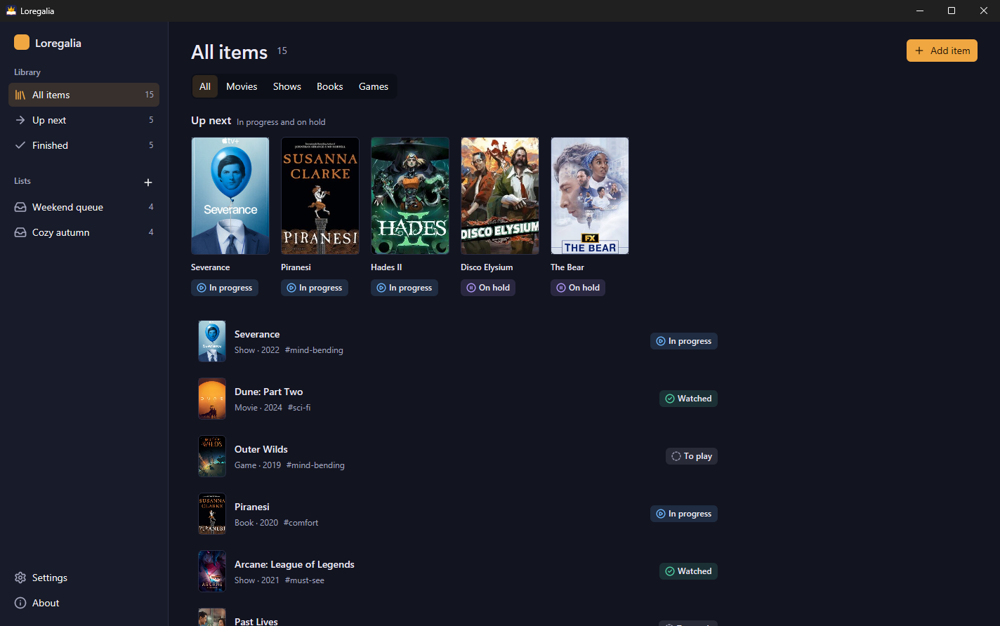
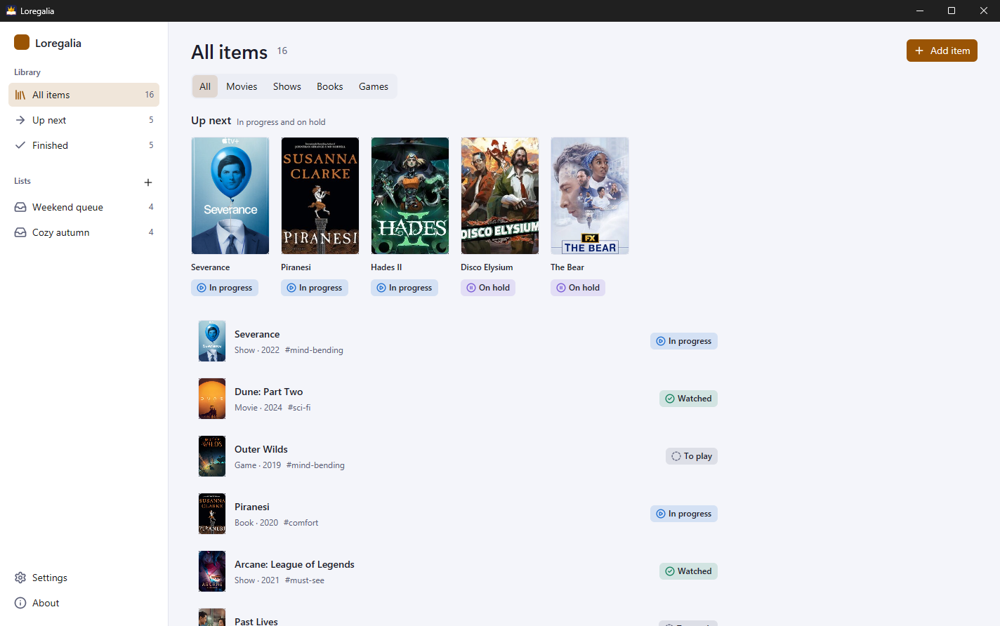
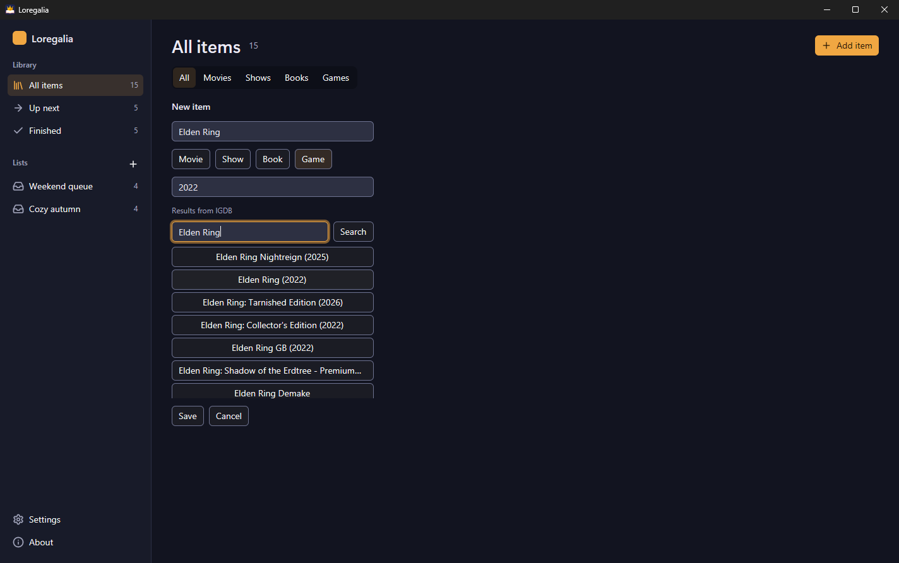
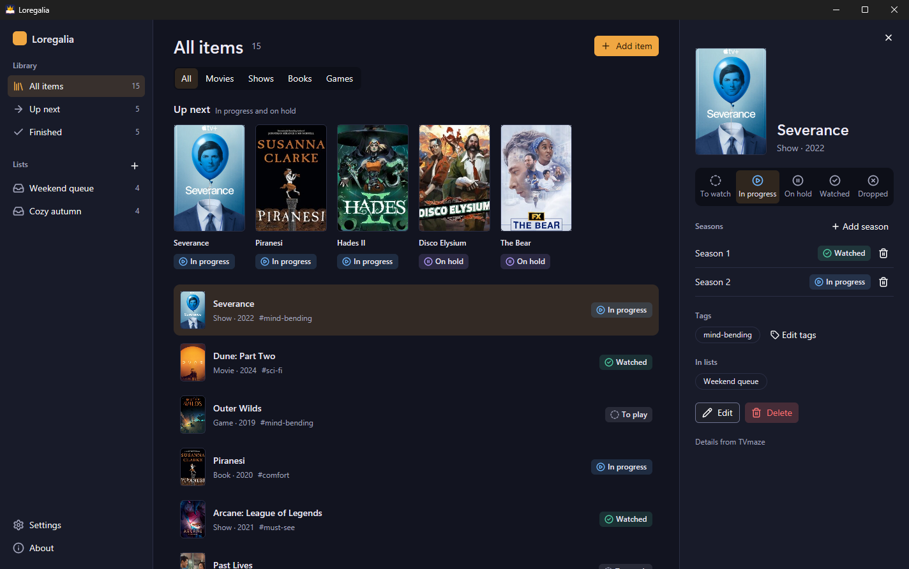
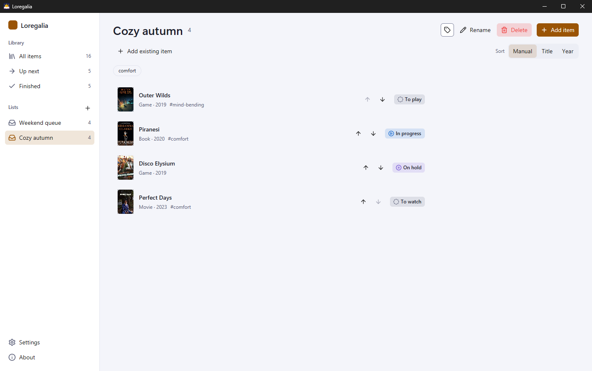

<h1 align="center">Loregalia</h1>

  <strong>Plan what to watch, read and play next.</strong> 
  Movies, shows, books and games in one calm library that lives on your computer.

  <a href="https://github.com/ManusolJ/loregalia/releases/latest"><strong>Download for Windows</strong></a>
  ·
  <a href="#features">Features</a>
  ·
  <a href="#privacy">Privacy</a>
  ·
  <a href="docs/TECHNICAL.md">For developers</a>

  

> [!IMPORTANT]
> **This project is built entirely with agentic AI.** AI coding agents write the code, tests and
> documentation. A human sets the direction, makes the product decisions, reviews the changes and
> merges them. Treat the code accordingly: it is checked by automated tests and human review, but it
> has not been written or audited line by line by a person. See
> [How it's built](docs/TECHNICAL.md#how-its-built).

## Why Loregalia

Your watchlist is in one app, your reading list in another, and the games you meant to play live in a
note somewhere. Loregalia puts them in one place, so when you have an evening free you can see
everything you wanted to get to and pick the next thing.

It is a **planner**, not a tracker. It helps you decide what to start, keeps what is in progress in
front of you, and remembers what you finished. It does not count episodes or pages, and it never asks
you to rate, review or share anything.

## Features

### One library for everything

Shows, movies, books and games sit side by side. **Up next** keeps what you are in the middle of at
the top, and **Finished** keeps a record of what you completed. Filter by kind with one click.

  

### Add things in seconds

Type a title and pick the match. Covers, years and details come from **TVmaze** for shows,
**TMDB** for movies, **Open Library** for books and **IGDB** for games. No account and no API keys
needed. You can also type anything in by hand.

  

### Plan one season at a time

Every item has a status that reads naturally for its kind: *To watch*, *To read*, *To play*,
*In progress*, *On hold*, *Watched*, *Dropped*. Shows can be split into seasons, each with its own
status, so you can finish season one and leave season two for later.

  

### Your own lists and tags

Make lists like *Weekend queue* or *Cozy autumn*, in the order you want, and put an item in as many as
you like. Tag lists and items with your own labels.

  

### Made to feel at home

- **Light and dark themes**, or follow Windows
- **Keyboard friendly:** Tab through items, Enter to open, Esc to close
- **Works offline:** your library, lists and statuses stay available without a connection; only
  covers and searches need one
- **Fast and small:** a native app, under 10 MB to download

## Privacy

- **Your library stays on your computer**, in a single file you can back up. There is no account,
  and nothing is uploaded.
- **Shows and books** are searched directly at TVmaze and Open Library, which see your IP address
  like any website.
- **Movies and games** go through a small Loregalia server that holds the API keys. It keeps no logs
  and nothing that identifies you. You can add your own TMDB or IGDB keys in Settings to skip it;
  they are stored in Windows Credential Manager, not in a file.

## Download

**[Get the latest release](https://github.com/ManusolJ/loregalia/releases/latest)**

| File | For |
| ---- | --- |
| `loregalia_<version>_x64-setup.exe` | Installs for your user, no administrator rights needed |
| `loregalia_<version>_x64-portable.zip` | Runs from any folder or USB stick, keeping its data beside it |

Loregalia runs on 64-bit Windows 11. Windows 10 should work but is not tested.

The builds are not code-signed yet, so Windows SmartScreen may warn about an unknown publisher.
Choose **More info**, then **Run anyway**. Each release lists SHA-256 checksums in
`SHA256SUMS.txt` if you want to verify your download.

## Credits

Metadata and covers come from [TVmaze](https://www.tvmaze.com/) (CC BY-SA 4.0),
[TMDB](https://www.themoviedb.org/), [Open Library](https://openlibrary.org/) and
[IGDB](https://www.igdb.com/). Covers in the screenshots belong to their respective owners.

This application uses TMDB and the TMDB APIs but is not endorsed, certified, or otherwise approved by
TMDB.

## Support

Loregalia is free, and every feature stays free. If it is useful to you, you can
[buy me a coffee on Ko-fi](https://ko-fi.com/manusolj).

Ideas and bug reports are welcome as [issues](https://github.com/ManusolJ/loregalia/issues).
Building it yourself, the architecture and the agent workflow are in the
[technical guide](docs/TECHNICAL.md).

## License

[MIT](LICENSE).
